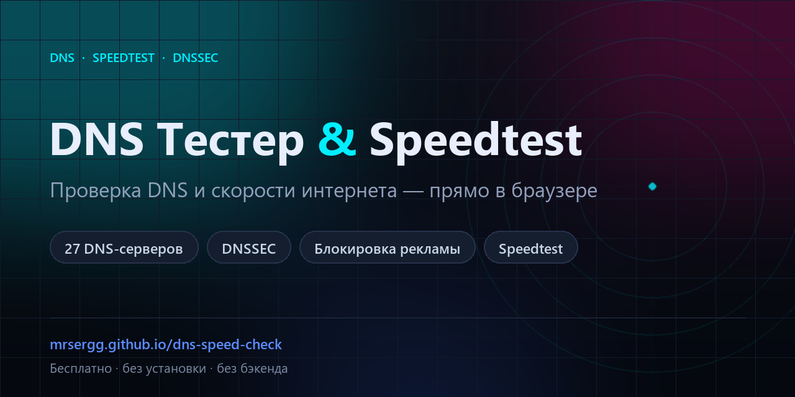

# DNS Тестер & Speedtest

**Сайт:** https://mrsergg.github.io/dns-speed-check/

Браузерный тест публичных DNS-серверов и скорости интернета. Без установки, регистрации и бэкенда: открыли страницу — проверили.

## Что умеет

- Проверяет 27 публичных DoH-серверов: задержка, подключение, ошибки, корректность ответов.
- Проверяет DNSSEC и блокировку рекламы.
- Показывает внешний IP, провайдера и примерный город при открытии страницы.
- По кнопке «Определить информацию» находит DNS-резолверы, PTR и организацию, проверяет DNSSEC по алгоритмам и измеряет задержку DNS.
- Speedtest: ping, скачивание, загрузка.
- Фильтры, сортировка, экспорт CSV, добавление своего DoH-сервера.

## Приватность

Запросы идут из браузера напрямую: к выбранным DNS-серверам, к `ipwho.is` / `ipapi.co` / `ipinfo.io` (IP и город), к `dnscheck.tools` и `addr.tools` (по кнопке), к Cloudflare и httpbin (speedtest). Результаты никуда не отправляются. Подробнее — в [legal.html](legal.html) и [THIRD-PARTY-NOTICES.md](THIRD-PARTY-NOTICES.md).

## Лицензия

GNU AGPL-3.0 — см. [LICENSE](LICENSE) и [NOTICE](NOTICE). Методика DNS-теста вдохновлена проектом [addr.tools](https://github.com/brianshea2/addr.tools) (AGPL-3.0).
